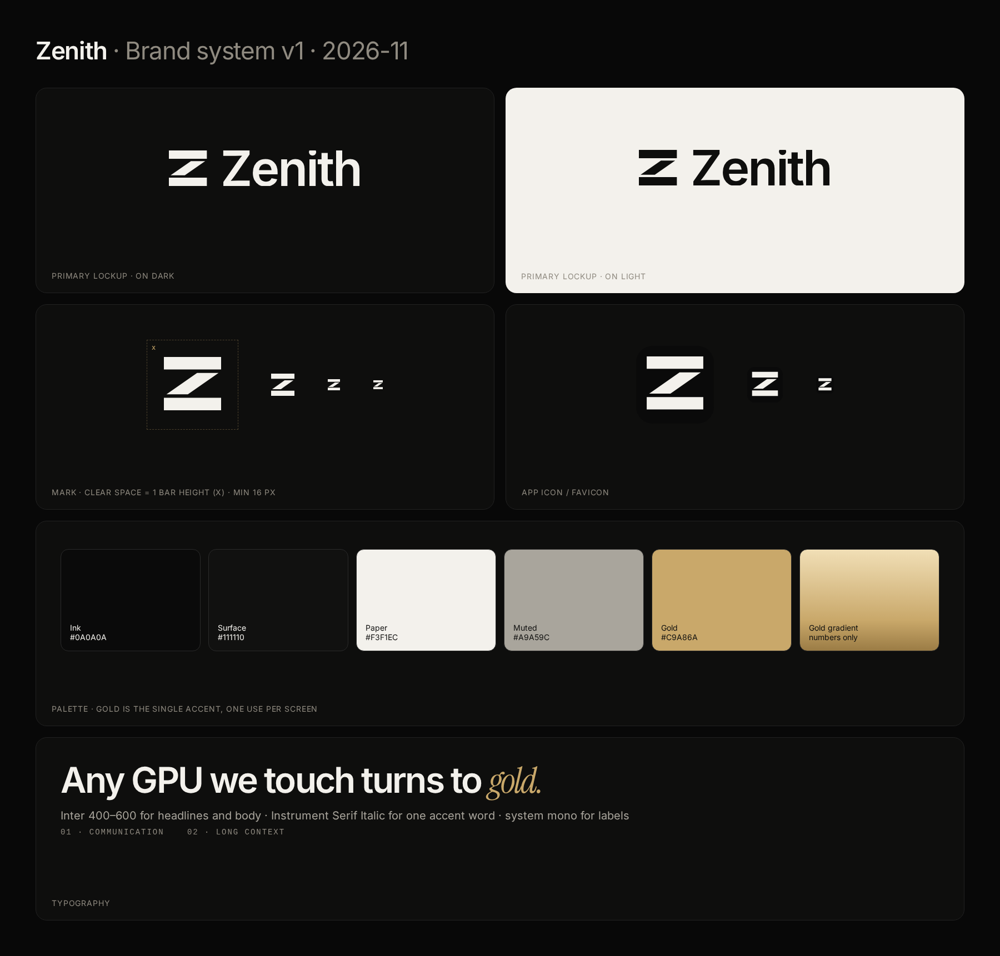

# Zenith brand system

Version 1, November 2026. The company was previously called Aitist. This document replaces all earlier Aitist guidance.

## 1. Name

- Write **Zenith**: capital Z, never all caps in running text.
- All caps (`ZENITH`) is only allowed in small mono labels and on product silkscreen, such as the GPU board in the 3D scene.
- The tagline is **Any GPU we touch turns to gold.** The one-line descriptor is *Efficient inference, from sand to service.*
- Trademark clearance for the name is still pending, so don't file or print at scale until it is done (see section 9).

## 2. Logo

**Mark.** A geometric Z made of three fitted stones: a top bar, a diagonal and a bottom bar. Hairline horizontal joints separate the three pieces. The idea is silicon strata: raw material stacked into something precise.

| File | Use |
|---|---|
| `brand/zenith-mark-light.svg` | Mark on dark backgrounds (default) |
| `brand/zenith-mark-dark.svg` | Mark on light backgrounds |
| `brand/zenith-lockup-light.svg` | Mark + wordmark, on dark (default) |
| `brand/zenith-lockup-dark.svg` | Mark + wordmark, on light |
| `brand/zenith-app-icon.svg` | App icon and favicon (`dist/favicon.svg`) |

**Construction.**
- The mark sits on a 128 × 120 grid. The bars are 28 units tall, the joints are 8 units, and the diagonal runs at the same slope as the bars' inner corners.
- In the lockup, the wordmark is Inter SemiBold set at cap height = mark height, with −3.5% tracking. The gap between mark and wordmark is 46 units.
- The lockup files have the wordmark converted to outlines, so they render without the font installed.

**Clear space.** Keep at least one bar height (x) of empty space around the mark and lockup.

**Minimum size.** 16 px for the mark; 72 px wide for the lockup. Below 16 px the joints close up; use the app icon instead.

**Don't:**
- recolor the mark gold;
- close the joints;
- rotate or skew it;
- add effects or outlines;
- put it on busy imagery without a dark scrim;
- rebuild the wordmark in another typeface.

## 3. Color

Zenith is a dark brand. Gold is the only accent, and it is used once per screen.

| Token | Hex | Use |
|---|---|---|
| Ink | `#0A0A0A` | Page background |
| Surface | `#111110` | Cards and tiles; keep the step from Ink small |
| Paper | `#F3F1EC` | Primary text, primary buttons, the mark |
| Muted | `#A9A59C` | Secondary text |
| Faint | `#6F6C66` | Labels, notes |
| Gold | `#C9A86A` | The single accent: the word *gold.* in the headline, key numbers |
| Gold gradient | `#F1DFB6 → #C9A86A → #9B7C45` | Large numbers only |

Avoid large fields of gold or yellow, bright section breaks (a light band between dark sections), and extra accent colors.

## 4. Typography

- **Inter** 400–600 for headlines and body. Headlines are set tight (−4% to −5.5% tracking) and kept to one or two lines.
- **Instrument Serif Italic** for a single accent word per headline, such as *gold.*, *further.* or *starting point.*
- **System mono** (`ui-monospace`) for small uppercase labels and indices, with 0.14em tracking. Use these sparingly.
- Both fonts are bundled in `dist/assets/fonts/` with their OFL licenses.

## 5. Imagery

One visual language: **sand becoming gold**.

- **3D (primary).** The real-time scene in `dist/assets/scene.js`. A sand river pours into a GPU module and leaves as gold, and the board turns gold on scroll. The supporting objects are a quartz crystal (silicon), a chip and a GPU module, plus a gold GPU. Renders for cards and covers come from the same scene (see `tools/`).
- **Photography (supporting).** Dark, warm, low-key macro work: sand turning to gold dust, a silicon wafer, a data-center aisle, gloved hands holding a GPU module. People are never identifiable.
- Everything is dark-ground and low-contrast, with gold as the only warm highlight.
- No stock-style clip art, no sci-fi HUD, grids or bloom, no rainbow palettes.

## 6. Layout and motion

- One idea per screen: a headline, one supporting line, and at most two buttons.
- Media leads. Text never sits on top of busy art; use split layouts or put the image above the text.
- Pill buttons: filled Paper for the primary action, a hairline outline for the secondary.
- Motion is slow and physical: eased reveals (about 1 s), the 3D river, and a scroll-linked gold transition. Respect `prefers-reduced-motion`.

## 7. Voice

- Measured, specific, evidence first. Every number links to its conditions ("a collective microbenchmark, not an end-to-end speedup").
- Short declaratives: "Show the work." "Results, measured."
- No superlatives without a measurement. Don't claim more than the test showed.

## 8. Website

- `dist/` is the current Zenith site. A preview is live at https://aitist.airacle-home.pages.dev (temporary Cloudflare Pages preview).
- See README for structure and how to re-render the 3D art.

## 9. Open items

- Trademark search for **ZENITH** in classes 9 and 42, in China (CNIPA) and the US (USPTO), including a design search for the Z mark.
- Final domain and contact email. The site still links to `contact@aitist.ai` and the `reports.aitist.ai` research reports.
- Production domain or subdomain for the site.
